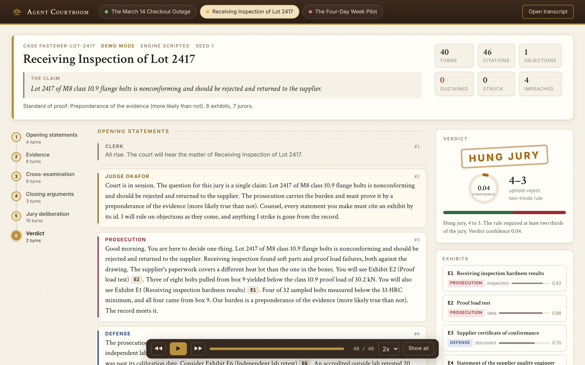
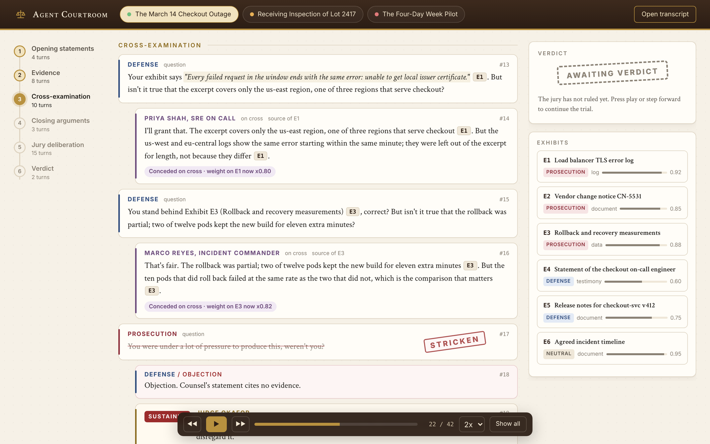
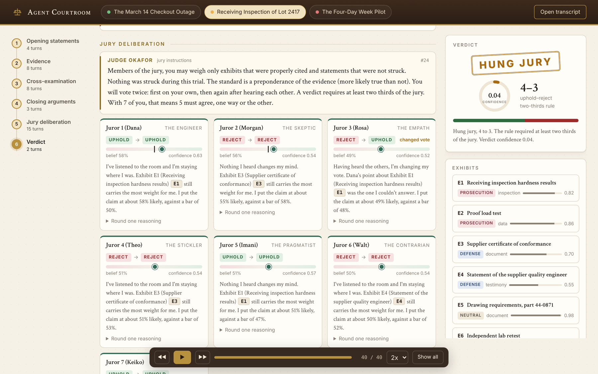
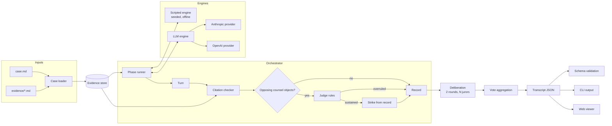

# Agent Courtroom

[](https://github.com/ataperata/agent-courtroom/actions/workflows/ci.yml)


Put a claim on trial. A prosecutor, a defense attorney, a judge and a jury of agents argue it from a set of evidence files, and every statement has to cite the record.

Getting language models to argue with each other is easy. Getting them to stay honest while they do it is the interesting part. In this courtroom, counsel must cite an exhibit for every statement, quotes are checked word for word against the evidence, and the judge strikes anything that fails. Jurors only ever see what survived. The result is a JSON transcript you can audit line by line, and a viewer that replays it like a court record.

It runs with zero API keys. `npm run demo` tries three bundled cases offline with a deterministic engine, so the whole pipeline (objections, rulings, cross-examination, two rounds of jury deliberation and a verdict) works on any machine. Add an Anthropic or OpenAI key and the same trial runs with real models.



## Quickstart

```bash
git clone https://github.com/ataperata/agent-courtroom.git
cd agent-courtroom
npm install

npm run demo       # three trials, offline, printed to the terminal
npm run viewer     # open the replay viewer at http://localhost:5173
```

Run one case with your own settings:

```bash
npm run trial -- cases/checkout-outage --jurors 9 --rule unanimous --seed 7
```

Run it live against a real model:

```bash
export ANTHROPIC_API_KEY=...      # or OPENAI_API_KEY=...
npm run trial -- cases/four-day-week --live
```

## What a trial looks like

| Phase | What happens |
|---|---|
| Opening statements | Each side states its theory and points at its strongest exhibits. |
| Evidence | Joint exhibits are entered by stipulation. Each side presents its own exhibits and quotes them. |
| Cross-examination | Each side presses the other side's two strongest exhibits on their weak spot. The witness answers, and a conceded weakness lowers that exhibit's weight. |
| Closing arguments | Prosecution, defense, then a short prosecution rebuttal. |
| Jury deliberation | The judge instructs the jury. Each juror votes on their own, then again after hearing the room. |
| Verdict | Votes are counted under the chosen rule and the judge announces the outcome with a confidence score. |

Objections can happen in any phase where counsel speaks. Every one gets an immediate ruling.



## The three bundled cases

| Case | Claim | Demo verdict (seed 1) |
|---|---|---|
| `checkout-outage` | The March 14 checkout outage was caused by the payment vendor's certificate rotation, not by our 08:55 deploy. | Upheld 7 to 0 |
| `fastener-lot-2417` | Lot 2417 of M8 class 10.9 flange bolts is nonconforming and should be rejected. | Hung jury, 4 to 3 |
| `four-day-week` | The four-day work week pilot increased the support team's throughput. | Rejected 0 to 7 |

Each case is a folder with a `case.md` and an `evidence/` folder of markdown exhibits: logs, measurements, documents, inspections and witness statements. They were written to be realistic and to cut both ways, so the outcome depends on how the evidence holds up under cross-examination, not on which side has more files.

## How the court keeps agents honest

### Citations

Every factual statement cites an exhibit id in square brackets. Quotes go in double quotes right before the bracket.

```text
The failures started two minutes after the rotation [E1].
Both logs agree [E1, E6].
The notice says "began at 09:00 UTC and introduced a new intermediate CA" [E2].
```

The citation checker ([`src/evidence/citations.ts`](src/evidence/citations.ts)) parses every turn and marks each citation valid or invalid. A quote passes if it appears in the exhibit after ignoring case, whitespace, curly quotes and markdown formatting. An ellipsis can skip text as long as the pieces appear in order. Changed words or numbers fail.

### Objections and rulings

After each statement by counsel, the other side checks it and objects if it finds a problem. The judge then rules. Rulings come from code, not from a model, so no agent can talk its way past a quote that is not in the record.

| Ground | Raised when | Sustained when |
|---|---|---|
| `uncited` | The statement cites nothing | It really cites nothing |
| `unknown-evidence` | It cites an id that is not in evidence | The id is not in evidence |
| `misquote` | A quote is not a character-for-character match | The quote fails the judge's normalized check |

Opposing counsel is deliberately stricter than the judge. A quote that only differs in capitalization draws an objection and gets overruled, which is how real courtrooms tend to work too. A sustained objection strikes the statement: its citations leave the record, a struck cross-examination question goes unanswered, and jurors never see it.

### Cross-examination

Each exhibit can declare a `weakness`, an `impact` (how much weight a conceded weakness removes) and an optional `rebuttal`. When a witness concedes the weakness, the exhibit's weight drops by its impact. If the witness has a rebuttal on the record, half of that is won back.

### The jury

Seven jurors by default (1 to 12 allowed), each with a temperament that changes how they read the same record:

| Temperament | Leans on | Notes |
|---|---|---|
| The Engineer | Logs, data, inspections | Discounts recollection |
| The Skeptic | Only high-reliability items | Sets a higher bar than the standard requires |
| The Empath | First-hand testimony | Moves toward the room in round two |
| The Stickler | Documents | Punishes a side that gets caught misquoting |
| The Pragmatist | Everything evenly | Asks what most likely happened |
| The Contrarian | Testimony | Moves away from the room in round two |
| The Auditor | Documents and records | Follows the paper trail |

In demo mode each juror forms a belief that the claim is true: the weight of the surviving evidence for the claim, divided by the total, with a fixed amount of doubt added to both sides so a thin record stays near 50/50. The juror votes to uphold if that belief clears the standard of proof plus their own temperament shift. In round two each juror moves toward (or away from) the room's average belief by their conformity. In live mode the model reasons from the filtered transcript and returns its vote, belief, confidence and reasoning as JSON.

### Vote aggregation and confidence

The verdict rule is `majority`, `supermajority` (two thirds, the default) or `unanimous`. If neither side reaches it, the jury is hung.

Verdict confidence combines how sure the winning jurors were with how lopsided the vote was:

```text
confidence = mean(confidence of the winning jurors) * (0.5 + 0.5 * margin)
margin     = (winning votes - losing votes) / jury size
```

A 7 to 0 vote of very sure jurors lands near their own confidence. A 5 to 2 split is discounted. A hung jury reports a low number that shows how far it was from a decision.



## Demo mode and live mode

Both modes run through the same orchestrator. The only thing that changes is the engine that writes each agent's words.

**Demo mode** (the default, no keys, no network). The scripted engine in [`src/engines/scripted.ts`](src/engines/scripted.ts) builds every line from the case file with choices drawn from a seeded random number generator. To give the judge something to do, it plants a few realistic mistakes chosen by the seed: an overstated quote (sustained), a quote that only differs in formatting (overruled), and a cross-examination question with nothing behind it (sustained, and the witness need not answer). The same seed gives a byte-identical transcript on every machine, and CI checks that the committed demo transcripts match a fresh run.

**Live mode** (`--live`). The LLM engine in [`src/engines/llm.ts`](src/engines/llm.ts) sends each agent its role's system prompt ([`src/agents/roles.ts`](src/agents/roles.ts)), the evidence and the transcript so far. Jurors get a transcript with struck statements, objections and rulings removed. Witnesses and jurors answer in JSON. The citation checker and the judge's rulings apply to model output exactly as they do to the demo, so an invented quote from a real model gets struck the same way.

Providers are plain `fetch` calls, no SDKs:

| Variable | Purpose |
|---|---|
| `ANTHROPIC_API_KEY` | Use the Anthropic Messages API (picked first when both keys are set) |
| `OPENAI_API_KEY` | Use the OpenAI Chat Completions API |
| `COURTROOM_MODEL` | Model id to use (or pass `--model`) |
| `ANTHROPIC_BASE_URL`, `OPENAI_BASE_URL` | Point at a proxy or a compatible endpoint |

Requests time out after 60 seconds and retry on 429 and 5xx responses with backoff. A live trial with seven jurors makes roughly 35 to 40 model calls.

## Architecture



The orchestrator ([`src/court/orchestrator.ts`](src/court/orchestrator.ts)) owns the order of play, the checks, the rulings and the vote count. Engines only produce words. That split is what makes the demo engine a fair stand-in for a model: both go through the same rules.

## Transcript format

A transcript is one JSON file described by [`src/schema/transcript.schema.json`](src/schema/transcript.schema.json). The main parts:

```jsonc
{
  "schemaVersion": "1.0",
  "mode": "demo",                 // or "live"
  "engine": "scripted",           // or "anthropic:<model>"
  "seed": "1",
  "case": { "id": "...", "claim": "...", "burden": "preponderance" },
  "evidence": [{ "id": "E1", "kind": "log", "reliability": 0.92, "favors": "prosecution" }],
  "participants": [{ "id": "juror-3", "role": "juror", "name": "Juror 3 (Rosa)", "temperament": "empath" }],
  "turns": [{
    "seq": 9, "phase": "evidence", "role": "defense", "kind": "statement",
    "text": "...",
    "citations": [{ "evidenceId": "E4", "quote": "...", "valid": true }],
    "struck": false
  }],
  "deliberation": [{ "round": 1, "votes": [{ "jurorId": "juror-1", "vote": "uphold", "belief": 0.59, "confidence": 0.63 }] }],
  "verdict": { "outcome": "hung", "rule": "supermajority", "tally": { "uphold": 4, "reject": 3 }, "confidence": 0.04 },
  "stats": { "objections": 1, "sustained": 0, "struckTurns": 0, "impeachments": 4 }
}
```

Objection turns carry `objection` and `refersTo`; ruling turns carry `ruling`; witness answers carry `impeachment`. `courtroom validate` checks a file against the schema and also cross-checks that turn numbers are in order, speakers exist, and the verdict tally matches the final round of votes.

## Write your own case

```text
cases/my-case/
  case.md
  evidence/
    e1-something.md
    e2-something-else.md
```

`case.md`:

```markdown
---
title: The Q3 Pricing Change
claim: Raising the base price in Q3 reduced new signups.
burden: preponderance        # or clear-and-convincing, beyond-reasonable-doubt
prosecution_theory: One or two sentences for the prosecution.
defense_theory: One or two sentences for the defense.
---
Background the agents will read.
```

Each exhibit:

```markdown
---
id: E1
title: Weekly signups
kind: data                   # log, data, document, testimony, inspection
source: Dana Reyes, growth analyst
reliability: 0.8             # 0 to 1
favors: prosecution          # prosecution, defense or neutral
summary: One sentence on what this shows.
quote: A sentence copied exactly from the body below.
weakness: The soft spot opposing counsel will press on.      # optional
impact: 0.4                  # optional, weight lost if the weakness is conceded
rebuttal: What the witness says back.                         # optional
misquote: An overstated version, used by the demo engine.     # optional
---
The exhibit itself, in markdown.
```

The loader rejects a case if a `quote` is not in the body, if ids repeat, or if a `misquote` would actually pass the quote check. Then run it:

```bash
npm run trial -- cases/my-case
```

## CLI

```text
courtroom demo [options]             Run every bundled case offline
courtroom run <case-dir> [options]   Run one case
courtroom list                       List bundled cases
courtroom validate <file.json>...    Check transcripts against the schema

--live                 Use a real model (same as --mode live)
--provider NAME        anthropic or openai
--model ID             Model id
--seed S               Seed for the demo engine (default 1)
--jurors N             Jury size, 1 to 12 (default 7)
--rule R               majority, supermajority or unanimous (default supermajority)
--out PATH             Where to write the transcript
--summary              Print only the verdict summary
--quiet                Print nothing but file paths
```

`npm run demo` writes to `web/public/transcripts/`, which is where the viewer looks. `npm run trial` writes to `out/<case>.json`; open that file in the viewer with the "Open transcript" button or by dropping it on the page.

The viewer works with the mouse or the keyboard: Space plays and pauses, the arrow keys step, Home restarts and End shows the whole record. Click any citation chip to open its exhibit. Add `?case=four-day-week&view=replay` to the URL to start a case from the first turn.

## Project layout

```text
src/
  agents/        role system prompts, juror temperaments
  court/         orchestrator, objections and rulings, juror scoring, vote aggregation
  engines/       scripted (demo) and LLM (live) engines
  evidence/      frontmatter reader, case loader, citation parser and checker
  providers/     fetch-based Anthropic and OpenAI clients
  schema/        transcript JSON schema and validator
  cli.ts         command line entry point
web/             Vite viewer (plain TypeScript, no framework)
cases/           three example cases
tests/           Vitest suites
scripts/         screenshot capture for this README
```

## Development

```bash
npm run typecheck   # tsc, strict mode
npm test            # vitest
npm run build       # CLI to dist/cli, viewer to dist/web
```

The tests cover citation parsing and quote matching, objection handling and rulings, vote aggregation under each rule, full trials with both engines (the live engine runs against a fake model that invents a quote and an exhibit, both of which must be struck), schema validation, and demo determinism. One test fails if the committed demo transcripts drift from a fresh run; `npm run demo` regenerates them.

CI runs typecheck, tests, build and the demo on Node 20 and 22.

## Limitations

- The demo engine is a scripted stand-in. Its arguments are assembled from the case files, so it argues competently but never surprises you. Live mode is where the agents actually reason.
- The quote checker is lexical. It catches changed words and numbers but cannot tell whether a correctly quoted line is being used out of context. That part is left to opposing counsel and the jury.
- Juror scoring in demo mode is a simple weighted model, tuned so the three cases produce three different outcomes under seed 1. Different seeds plant different mistakes and can change verdicts.
- The default model ids can go stale. Set `COURTROOM_MODEL` or `--model` to whatever your account offers.

## License

MIT. See [LICENSE](LICENSE). Copyright (c) 2026 Ata Perata.
